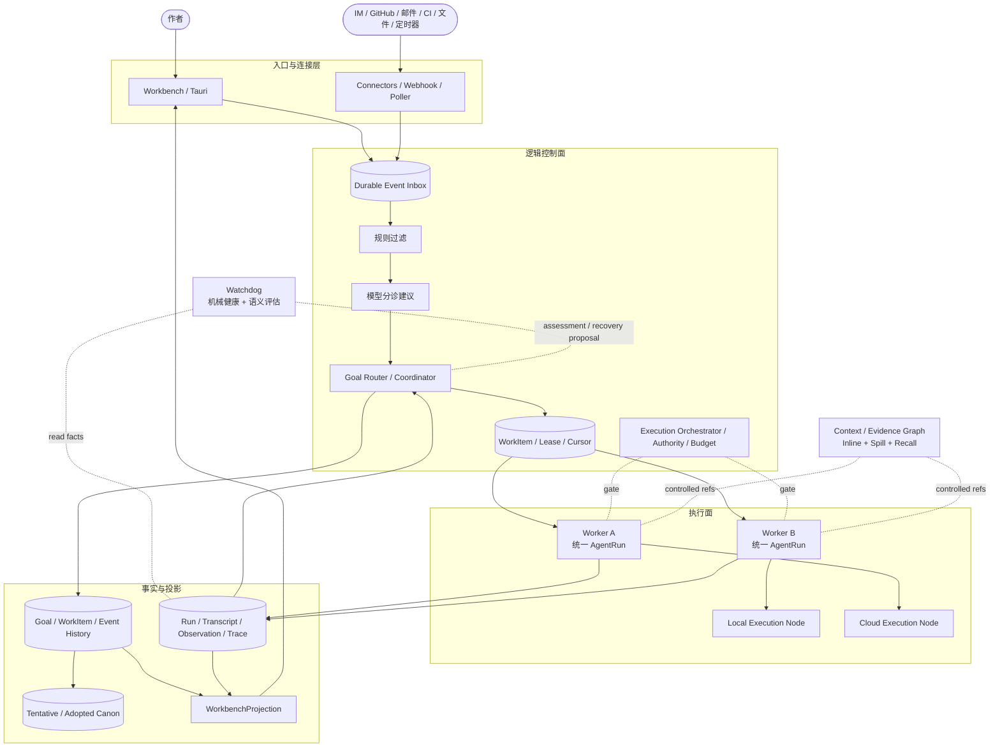

# Goal-centric 持续运行目标架构评审稿

- 状态：**Deferred / 暂缓评审（待项目愿景与元原则全面核对及作者研究）**
- 日期：2026-11-01
- 任务入口：[B77-goal-centric-runtime-architecture](../../tasks/slices/B77-goal-centric-runtime-architecture.md)
- 当前实现基线：[00d-runtime-architecture](00d-runtime-architecture.md)、[UA-01](contracts/UA-01-unified-agent-run-loop-contract-pack.md)、[ADR-0021](adr/ADR-0021-agent-run-and-turn-boundary-v3.md)、[ADR-0033](adr/ADR-0033-authoring-run-transcript-request-ir-v3.md)
- 影响范围：Goal / Event / AgentRun / LongRunTask / WorkSession / TurnResult / Context / Trace / UI / Desktop / Cloud / Umbrella
- 评审成熟度：C1 架构与逻辑对象草案；不是 Accepted ADR、冻结 schema、implementation plan 或实施授权

> 本稿仅是研究初稿。2026-11-01 作者指出其尚未全面检查设计、核对项目愿景与元原则；因此当前不请求 R1–R7 裁决，也不能据此进入 ADR 或实现。`00d` 与现役 Accepted ADR 仍是实现基线。即使未来重新开放并接受方向，也必须逐条完成 §18 的正式迁移，不能让两套架构长期同时作为权威。

---

## 0. 评审摘要

建议把当前“作者 Turn / WorkSession 拥有 AgentRun”的控制面，整体重构为：

```text
事件驱动 Goal
→ Goal 调度 WorkItem
→ Worker 执行统一 AgentRun
→ RunResult / Observation / Artifact 回写控制事实
→ Goal 推进或等待
→ WorkbenchProjection 为作者提供统一视图
```

核心判断有六点：

1. **持续在线的是 Goal、事件订阅和持久状态，不是 Session 或永不退出的 Worker 进程。**
2. **Router 是确定性控制面，不是重新回来的 Router-first 意图路由层。**
3. **统一 AgentRun 继续是模型计划、求证、工具和作者出口的执行内核，不新建第二 Agent 循环。**
4. **Goal / WorkItem / AgentRun 分层后，`LongRunTask` 的独立调度生命周期和 `bounded / durable` 双语义应被迁移吸收，而不是继续叠加。**
5. **作者主权、逐步 Orchestrator gate、tentative-first、证据引用、N-NARR 和 replay 边界全部保留。**
6. **24×7 需要常开控制面；Tauri sidecar 不能在机器关机时伪装持续在线。跨设备采用单一逻辑写者，不做多主 Session 合并。**

---

## 1. 为什么必须重构控制面

### 1.1 当前执行内核已有可承接资产

现有系统已经具备：

- `AgentRun / AgentPlan / AgentStep / AgentObservation / AgentEvent`；
- supervised bounded runtime 与 durable checkpoint/recovery；
- 模型计划与偏离后的 replan；
- 每个 act step 重新经过 `MicroPlan → ExecutionOrchestrator`；
- tentative artifact、作者采纳、作者问题与动作回执；
- 最小 Base、真实观察回流、used refs 证据绑定；
- ADR-0033 的 Authoring Run Transcript / Request IR 目标，以及追加式消息、显式 checkpoint 的修订方向。

这些是需要保留的执行与证据资产，不是需要重写的业务功能清单。

### 1.2 当前所有权仍假设“对话发起一切”

`NovelDomain.AgentRun` 当前把 `session_id`、`parent_turn_ref`、`origin_frame_ref` 作为必填身份，见 `apps/novel_domain/lib/novel_domain/agent_run.ex`。ADR-0021 也把 AgentRun 定义为作者 turn 下的执行会话。

如果外部事件直接沿用这一模型，只能有两种错误选择：

- 为 GitHub、邮件、CI 等事件伪造用户 Session、Turn 或 DialogueFrame；
- 在现有模型旁新增事件专用 runtime，形成第二套预算、权限、恢复和 trace。

两者都不可接受。正确迁移是让 Turn 成为一种来源，让外部 Event 成为另一种平级来源。

### 1.3 当前运行与等待语义分散

目前同时存在：

- AgentRun 的 `status / phase / run_mode`；
- LongRunTask 的 `Status / TaskPhase / checkpoint_data`；
- BehaviorState 的等待与关闭；
- WorkSession 的 ACTIVE / EXITED / ARCHIVED；
- ProviderExecution 的取消与存活；
- bounded runtime 丢失后的特殊收口。

这些对象各有历史职责，但持续目标若直接叠加其上，会出现“Worker 已完成、Task 仍 RUNNING、Run  awaiting_author、Session 已退出、UI 又显示待机”之类的组合歧义。目标架构必须先明确状态所有权，再讨论新进程或新连接器。

### 1.4 现有 LongRunTask 不应成为新控制面的底座

`TaskRunner.start/resume` 的真实异步执行仍是占位逻辑；当前真实消费者主要是同步动作的 task_state 包装，见 `apps/novel_application/lib/novel_application/task_runner.ex` 与 [04a §10](04a-planning-and-long-run.md)。

因此，目标不是给这个桩补事件、Worker 和 Watchdog，而是把其中有价值的逐单元、预算、checkpoint 和 tentative 语义迁入统一 WorkItem，最终退役重复执行入口。

---

## 2. 目标与非目标

### 2.1 目标

1. 作者、IM、GitHub、邮件、CI、本地文件和定时器都能经同一控制语义驱动工作。
2. Goal 可跨消息、跨进程、跨设备和跨等待存续，但不要求用户手动管理 Session。
3. 独立工作可以并行；同目标的状态推进仍有确定顺序和总预算。
4. 长任务后台执行时，作者可以继续交流、调整方向或处理其他目标。
5. 进程崩溃、节点离线、重复投递和模型死循环都有明确、可验证的恢复边界。
6. Context 只投影当前需要的信息，历史与关联对象沿真实引用按需召回。
7. 云端控制面能够调用用户本地能力，同时保持权限收缩、版本一致和审计。
8. 所有自动行为仍受作者主权、权限、预算、采纳和外部副作用门禁约束。

### 2.2 非目标

- 不把多 Agent 等同于多个永久 GenServer 或多个角色名称。
- 不让 Worker 之间自由互发自然语言并形成不可追踪的协作网络。
- 不在首期同时实现 IM、GitHub、邮件、CI 等全部连接器。
- 不追求理论上的“恰好一次投递”或跨节点多主写入。
- 不把 PubSub 当持久事件队列，不把 provider response id 当恢复事实源。
- 不让事件负载、模型分诊或 Watchdog 获得自我扩权能力。
- 不在本稿冻结数据库表、JSON 字段、枚举全集、队列产品或分布式依赖。
- 不在本稿自动重新开放 B52 的批量初稿产品入口；批量需求仍需独立产品裁决。
- 不在本稿修改生产代码、启动后台任务、调用真实模型或接入真实第三方账号。

---

## 3. 方案比较与推荐

| 方案 | 结构 | 优点 | 根本问题 | 建议 |
|---|---|---|---|---|
| A | 在 Session / Turn 上增加后台 Task、事件监听和 Watchdog | 初期改动较小 | 外部事件仍需伪造 Turn；状态所有权继续分散；最终形成补丁集合 | 不采用 |
| B | 新建独立 Goal Runtime，与现有 AgentRun 并行 | 新能力表面上不受旧契约约束 | 两套计划、预算、权限、trace、恢复和 UI 必然漂移 | 不采用 |
| C | Goal 控制面 + WorkItem 调度 + 统一 AgentRun 执行内核 | 一个执行内核、一个权限边界、一套证据与恢复语义；可逐条迁移现有资产 | 需要正式修订 ADR-0021、LongRunTask 和 UI canonical 输出 | **推荐** |
| D | 全量 Event Sourcing + 分布式 Agent 集群一次到位 | 理论上统一事件历史与弹性扩展 | 首期复杂度过高；当前桌面 / SQLite / 单作者并不能证明其必要性 | 不采用为目标前提 |

推荐 C，但不要求 Big Bang 一次性上线。实施可以分垂直闭环推进，前提是目标对象、状态归属和最终退役关系先统一，迁移期兼容层不得变成第二套永久权威。

---

## 4. 目标上下文与运行拓扑



### 4.1 Router 不是什么

- 不是作者和 LLM 之间的意图分类器；
- 不是全局同步 GenServer；
- 不是全局巨型 Prompt 的持有者；
- 不直接执行工具；
- 不把 `AgentPlan.steps` 批量转成 ToolRequest；
- 不批准自己的调度建议越过 Execution Orchestrator。

Router 的逻辑单一性通过 `goal_id` 分区、Goal 版本和数据库条件更新保证，不要求所有工作经过一个物理进程。

### 4.2 Worker 不是什么

- 不是永久在线的人格 Session；
- 不是安全边界的全部；
- 不拥有 Goal 总预算或最终成功裁决；
- 不直接写 canon；
- 不通过子 Worker 获得比父 WorkItem 更大的权限。

BEAM 提供故障隔离和调度基础；Shell、文件写入、外部账号等能力仍需 OS 沙箱、目录权限、短期凭据和效果回执。

---

## 5. 统一对象模型与状态所有权

目标关系：

```text
Goal 1 ── n WorkItem 1 ── n AgentRun 1 ── n AgentStep
 │             │                 │
 │             │                 └── Transcript segment / Observation / RunResult
 │             └── Lease / dependency / budget allocation / wait condition
 └── Objective / success criteria / authority / total budget / version

Conversation / Turn / External Event = 来源与交互事实，不是上述对象的必经父级
```

### 5.1 Goal：持久目标，而非一次 Prompt

Goal 是长期协作的根对象，逻辑上至少包含：

| 维度 | 含义 |
|---|---|
| 身份与作用域 | `goal_id`、workspace、可选 work、明确的资源边界 |
| 目标与版本 | 当前目标文本、成功条件、目标版本、被替代关系 |
| 来源 | 初始 author turn、external event 或系统策略 |
| 权限与预算 | 总 authority scope、总预算、自动行为策略 |
| 当前推进 | 当前版本、状态、等待原因、活动 / 待处理 WorkItem |
| 结果与证据 | 关键结果 refs、未解缺口、最近有效 checkpoint |

Goal 不是简单的 `{text, version}`。成功条件必须区分：

- “生成一个候选”可以在 tentative artifact 形成后完成；
- “完成并保存章节修订”必须包含作者采纳，不能把 Worker completed 当作 Goal completed。

普通短问答可以自动创建并快速关闭 Goal，不要求用户命名或管理。

### 5.2 EventEnvelope：控制面输入事实

EventEnvelope 表达“系统接收到了什么”，逻辑上包含：

- 内部 event id、source、外部 source event id、event type；
- workspace / work / author / device 等作用域；
- occurred_at / received_at；
- payload 或 payload ref、内容摘要、信任级别；
- correlation / causation refs；
- 去重键、来源游标、验签与接收状态。

外部 payload 是数据，不天然是作者命令。只有经过身份映射、权限和策略校验的输入，才能成为具有相应授权的作者动作或系统触发。

EventEnvelope 与现有 `AgentEvent` 不同：

- EventEnvelope 驱动控制面，必须可持久去重和恢复；
- AgentEvent 是 Run 的作者安全 / developer 活动投影，不承担可靠队列职责。

### 5.3 WorkItem：可调度工作单元

WorkItem 是 Router 的调度与恢复单位，逻辑上包含：

- 所属 Goal、依赖、资源作用域和优先级；
- 分配预算、收缩后的 authority、执行能力要求；
- 当前状态、lease owner、lease epoch、到期时间；
- attempt 次数、当前 / 历史 Run refs；
- 等待条件、重试类别、下一可执行时间；
- 输入、输出和 checkpoint refs。

WorkItem 不是创作计划，不向作者展示为另一套 PlanStep，也不要求每个 `AgentPlan.step` 都变成一个 WorkItem。

### 5.4 AgentRun：一次连续执行尝试

建议把 AgentRun 从“作者 Turn 下的受限会话”改为：

> AgentRun 是 Worker 对某个 WorkItem 的一次连续执行尝试；它可以完成、失败、取消，或在遇到等待条件时保存 checkpoint 并挂起。

目标语义：

- WorkItem 是跨等待的逻辑工作身份；
- AgentRun 是一次 attempt；
- 需要等待作者、外部事件、设备或预算时，Run 输出 `Suspension`，WorkItem / Goal 持有等待；
- 等待条件满足后，可以从有效 checkpoint 创建新的 Run attempt，并以 `previous_run_ref` 组成连续 lineage；
- 活跃 Run 中的作者 steer 可在安全边界内进入当前 attempt；需要重规划或跨授权边界时，通过同一挂起 / 新 attempt 语义处理；
- 每次 attempt 有自己的 Transcript segment，WorkItem 通过 checkpoint 和前序 refs 恢复连续请求，不改写历史 segment。

这样可以消除“同一个 Run 既跨重启永久存续、又只是一次内存进程”的歧义，也让 Worker 真正可替换。

### 5.5 Conversation / Session / Turn

- Conversation 是作者交流线程和展示范围，可以关联多个 Goal。
- Session 如需保留，只作为 Conversation 的内部实现或历史兼容概念，不再是执行所有权。
- Turn 保存作者原话、作者动作和授权边界，继续满足 I-M / I1 等因果要求。
- 外部事件驱动的 Run 不伪造 Turn、DialogueFrame 或作者消息。
- 作者动作应绑定 Goal / WorkItem 及预期版本；不再默认以永久 run_id 作为跨等待唯一控制目标。

### 5.6 RunResult 与 WorkbenchProjection

后台执行不能强迫所有结果都进入 TurnResult：

- `RunResult` 是一次执行尝试的结构结果：完成、挂起、失败、取消，以及 artifact / observation / failure refs。
- `GoalProjection` 表达目标、工作项、等待、预算和结果的作者可读状态。
- `WorkbenchProjection` 是 UI 的唯一主读模型，组合 Conversation、Goal、待办、通知和可用动作。
- `TurnResult` 继续是作者对话交互结果，可以成为 WorkbenchProjection 的组成，但不再是所有后台事实的唯一出口。

这不是让前端直接读取 Goal / WorkItem / AgentRun 内部表。ADR-0015 所保护的“UI 不成为第二 Orchestrator”原则必须保留，只是 canonical UI envelope 需要从 TurnResult 扩展到统一 WorkbenchProjection。

### 5.7 WorkItem、AgentPlan 与 Delegation 的边界

- `AgentPlan` 仍由模型制定和维护，表达 Run 内的创作计划与里程碑。
- WorkItem 是系统调度事实，不替模型预制创作路线。
- 模型若认为需要独立工作，可以提出 `DelegationRequest`；它不是执行授权。
- Execution Orchestrator 校验后，Router 才能创建子 WorkItem，并分配更小的权限与预算。
- 子 WorkItem 的结果以 RunResult / Observation / Artifact 回到父级，保留来源与版本，不通过私有 Agent 消息暗传。

---

## 6. 状态模型与写入一致性

### 6.1 Goal 状态与等待原因分离

以下是待评审的逻辑状态，不是立即冻结的枚举：

```text
proposed → active ⇄ waiting → completed
                  ├──────────→ failed
                  └──────────→ cancelled
```

`waiting` 必须有结构化原因，例如：

```text
author / event / dependency / device / budget / policy / retry
```

规则：

1. Goal 状态只能由逻辑 Goal coordinator 按版本推进。
2. Goal 内状态转换串行，不代表 Goal 内所有 WorkItem 必须串行执行。
3. 独立 WorkItem 可以并行；共享资源冲突、依赖或总预算仍可限制并行。
4. Goal completed 必须满足其成功条件，不等于任一 Worker completed。
5. 等待不是进程存活承诺，也不是失败。

### 6.2 WorkItem 状态与 lease 分离

建议收敛为：

```text
pending → running ⇄ waiting → succeeded
            │  ├─────────────→ failed
            │  └─────────────→ cancelled
            └→ pending（可重试，attempt + 1）
```

- `pending` 可携带 `next_attempt_at`；
- lease 是运行所有权，不是业务状态；
- `running` 必须有有效 lease epoch；
- 可重试失败回到 pending，不以 failed 终态冒充；
- failed / cancelled 是否影响 Goal，由依赖、成功条件和恢复策略决定。

AgentRun 保留自己的执行状态，但不再复制 Goal 的长期等待和 WorkItem 的调度重试。

### 6.3 持久事件 + 版本化快照，不要求全量 Event Sourcing

推荐：

- Event、Goal、WorkItem、Run 和 effect 记录有持久事实；
- Goal / WorkItem 当前快照与对应历史事件在同一数据库事务中推进；
- 快照带版本，历史只追加；
- 恢复优先读取当前快照与 checkpoint，按需核对历史，不要求每次从创世事件重放；
- Trace / Replay 仍能解释每次转换为什么发生。

这是一种事件驱动持久控制面，不把“全系统只能由事件日志重建”作为首期复杂度前提。

---

## 7. 事件驱动与主动工作

### 7.1 入口可靠语义

Connector 负责协议适配，不负责业务授权：

```text
Webhook / Poll / Local notification
→ 验证来源与作用域
→ Durable Inbox（去重键 + 来源游标）
→ 提交后发出唤醒通知
```

- 采用至少一次投递 + 消费幂等，不宣称恰好一次。
- PubSub 只用于唤醒和实时展示；进程重启后以持久 Inbox / cursor 为准。
- 轮询 cursor 与事件接收必须可恢复；来源重复、乱序和重放均按显式规则处理。
- SQLite 单机可承担持久队列；云端多节点再采用相应数据库能力，不要求一开始引入外部 broker。

### 7.2 两级过滤

| 级 | 责任 | 明确不能做 |
|---|---|---|
| 程序规则 | 验签、去重、作用域、订阅、速率、冷却、预算、明确禁止项 | 不用关键词替代完整语义判断 |
| 模型分诊 | 相关性、Goal 归属、优先级、建议动作、理由与证据需求 | 不直接创建授权、不直接执行副作用 |

模型分诊应是异步、可持久审计的 `TriageDecision`，并计入系统或 Goal 预算。Router 只消费经过结构与策略校验的分诊结果；模型调用不得阻塞整个 Router。

### 7.3 Goal 归属与缺口诚实

- 显式回复某个 Goal 卡片或问题，优先绑定该 Goal 和版本。
- 模型可建议归属现有 Goal 或新建 Goal，但须依据真实候选集合。
- 归属不明时进入待分诊收件箱或请求作者选择，不默认附加到“最近 Goal”。
- 跨 work 默认禁止；workspace 级 Goal 必须有明确作用域和权限。
- 外部 IM 身份只有映射到已授权作者后，才能获得对应作者动作权限。

### 7.4 推测执行与提前工作

用户还在讨论方案时，系统可以创建受限推测 WorkItem，例如只读复现、证据收集或 tentative 候选。每个推测项绑定：

```text
goal_version
source_revision / target_revision
validity_scope
speculation_policy
budget_cap
```

目标或源版本改变后，旧推测结果只能重新验证、标记 stale 或丢弃，不能静默生效。推测工作默认只读和 tentative，并具有独立低成本预算、取消和冷却规则。

---

## 8. 调度、并行、预算与副作用

### 8.1 调度规则

Router 根据以下条件选择 WorkItem：

- 依赖已满足；
- Goal / WorkItem 未等待、未取消；
- 资源作用域不冲突；
- 执行节点能力匹配；
- 总预算和自动行为策略允许；
- 没有更高优先级或冷却限制。

派发通过数据库条件更新一次性获得 lease，并增加 lease epoch。旧 Worker 即使仍然存活，也不能用过期 epoch 提交新事实。

### 8.2 预算

- Goal 持有总预算，WorkItem 只获分配额度。
- Run、Provider、工具和模型分诊的实际消耗进入同一总账。
- 子 WorkItem 权限和预算都只能收缩。
- 重试、Watchdog 恢复和推测执行也消耗预算，不能成为免费旁路。
- 预算耗尽可能形成等待作者或降级，不自动扩额。

### 8.3 外部副作用

非幂等副作用必须经过 Execution Orchestrator 和统一 effect 记录：

```text
EffectRequest → policy / authority / freshness gate
→ dispatch with idempotency key
→ receipt / timeout reconciliation
→ EffectResult
```

网络超时不能直接被解释为“未执行”。对发送邮件、推送代码、第三方写入等动作，必须查询回执、进入 reconciliation 或等待作者，不能盲目重放。

---

## 9. Context：Inline、Spill 与 Chain of Recall

### 9.1 三个概念保持分离

- **Context**：本次给某个消费者的受控投影。
- **Memory / Canon / Artifact**：可长期引用的业务对象与事实。
- **Trace / Transcript**：实际发生过的认知、工具、裁决与消息事实。

Inline / Spill 是 Provider 投影策略，不是删除或改写这些事实的方式。

### 9.2 Inline：当前工作集

Inline 只包含：

- 当前 Goal、WorkItem 和必要约束；
- 当前权限、预算、资源与版本 scope；
- 稳定 product / run 协议；
- 活跃 Transcript 后缀和有效 checkpoint；
- 可继续召回的引用游标。

Router 只接收目标与调度摘要，不因“全局协调”而持有所有作品、邮件和历史对话全文。

### 9.3 Spill：可寻址外部对象

Spill 对象包括 Event、历史 Run segment、Observation、作品对象、Artifact、外部 Issue / 邮件 / CI 日志和大文件。它们需要：

- 稳定 ref、类型、版本、内容 digest；
- 来源、信任与权限；
- 覆盖范围、省略和 freshness；
- 可回查的存储位置。

### 9.4 Chain of Recall：有界的逐跳求证

引用图可以表达：

```text
Goal → origin Event → related WorkItem → previous Run
     → Observation → Artifact / Canon → prior revision
```

每一跳都必须：

1. 经统一只读探索 / 引用续读工具；
2. 重新检查作用域、权限、版本和信任边界；
3. 受深度、费用、循环与结果大小限制；
4. 形成真实 Observation 并进入后续 Transcript；
5. 满足 `used_refs ⊆ Base ∪ 实际观察`；
6. 对 missing / stale / partial / unauthorized 诚实表达。

禁止 Context Assembler 自动递归水合整张图。Chain of Recall 是模型按需求证的能力，不是新的固定 prompt packet。

### 9.5 与 ADR-0033 的关系

- AgentRun 仍是 Provider 请求的运行事实源。
- 每个 Run attempt 有稳定、可重建的 Transcript segment。
- 跨 attempt 恢复通过前序 refs + checkpoint + 当前 scope 重建，不把旧 Prompt 字符串当事实源。
- 初始 Base 与既有消息保持稳定；权限、预算和作品版本变化按显式 scope 更新。
- §10 的 G7 / G8 修订当前仍是 Proposed，必须与本架构一起评审，不能在文档中提前当作已实现事实。

---

## 10. 异步、持久在线与跨设备执行

### 10.1 计算、状态与执行环境分离

- 控制面保存 Goal、WorkItem、事件、lease、预算和结果事实。
- Worker 是可替换计算过程。
- Execution Node 提供本地文件、桌面、Shell、云端计算等实际能力。
- Node 不直接拥有控制面数据库，也不因持有任务而获得长期凭据。

### 10.2 单一逻辑控制面

同一 workspace / Goal 只有一个逻辑写者。控制面可以部署为：

- 当前桌面 sidecar：应用和机器运行时可用；
- 云端或常开服务器：支持 24×7 和跨设备；
- 用户自托管常开节点：同等逻辑约束。

不允许云端与桌面同时对同一 Goal 多主推进。离线输入可排队，重连后按版本裁决；不能自动合并两个互相不知道的 Goal 版本。

### 10.3 Execution Node 协议语义

Node 与工作分配之间至少需要表达：

- node identity、capabilities、workspace scope；
- WorkItem、lease epoch、输入 refs、权限和预算；
- heartbeat、Run event、checkpoint 和 RunResult；
- 内容 digest、效果回执与取消。

断连时：

- 不颁发新的授权；
- 已过期 lease 的结果不被直接接收；
- 非幂等副作用进入对账；
- Goal / WorkItem 显示等待设备或恢复，而非虚假 running；
- 本地是否可继续只读工作由明确 delegated policy 决定，不能形成第二控制面。

---

## 11. Watchdog：独立评估，统一恢复门禁

### 11.1 两层健康判断

| 层 | 典型输入 | 可判定问题 |
|---|---|---|
| 机械健康 | 进程、lease、heartbeat、wire data、事件序号、预算计数 | crash、失联、lease 过期、持久化停滞、事件乱序 |
| 语义健康 | Goal / Plan / Observation / RunResult / repeated signature | 死循环、目标漂移、重复求证、成功条件失真、异常预算消耗 |

现有 Provider wire 超时、no-progress、AgenticDeviationSignal 和预算检测作为输入复用，不另造重复规则。

### 11.2 独立性的真实含义

- 与 Worker 分离进程和权限；
- 默认只读运行事实；
- 模型语义评估失败时，机械健康检测仍有效；
- Watchdog 自身由 OTP 和机械心跳监督，不递归制造“语义 Watchdog 的 Watchdog”。

### 11.3 恢复动作

Watchdog 输出 `HealthAssessment / RecoveryProposal`，由同一控制面裁决：

1. 仅记录异常；
2. 请求 replan；
3. 先使旧 lease 失效，再从有效 checkpoint 创建新 attempt；
4. 暂停 WorkItem / Goal；
5. 取消或等待作者。

Watchdog 不能采纳 artifact、修改 canon、扩大预算、伪造成功或无限重启。所有恢复消耗预算并保留因果 trace。

---

## 12. 作者体验与主权

### 12.1 用户看到的是工作，不是 Session 管理

Workbench 应以统一投影呈现：

- 正在推进、等待作者、等待事件、等待设备的 Goal；
- 每个 Goal 的来源、当前活动、预算和下一步；
- 待采纳、待确认、待分诊和失败恢复；
- 可用 Execution Node 与离线状态；
- 与 Goal 关联的对话、证据和结果。

历史 Session 可以保留只读访问，但新目标不要求作者创建或切换 Session。

### 12.2 对话仍是主要交互面

Goal-centric 不等于表单化或任务后台化：

- 作者仍通过自然语言与同一创作伙伴交流；
- 作者可见叙事仍来自模型，不由 Router / Watchdog 代写；
- Goal、WorkItem 和事件是系统内部结构，按需以作者可理解方式呈现；
- 多活动 Goal 时，自由输入的归属必须显式或可解释，不能静默猜测。

### 12.3 自动行为默认边界

推荐默认：

- 自动：只读调查、求证、复现、分析和 tentative 候选；
- 需策略或作者批准：权威作品写入、外部消息、代码推送、共享数据、提高预算和高风险本地动作；
- 永远禁止：模型 / 事件 / Watchdog 自我采纳、自我扩权或绕过 receipt。

---

## 13. 事实来源边界

| 事实 | 目标事实源 | 不是事实源 |
|---|---|---|
| 作者原文与动作 | 持久 Turn / Action / Receipt | 前端临时气泡、模型摘要 |
| 外部输入 | Durable EventEnvelope + 来源游标 | PubSub 通知本身 |
| Goal 当前状态 | 版本化 Goal 快照 + 同事务历史 | Worker 内存、最新 UI 卡片 |
| 调度与重试 | WorkItem + lease epoch + attempt lineage | AgentPlan、进程 pid |
| Run 执行与 Provider 请求 | AgentRun + Transcript + Observation | provider response id、旧 prompt 字符串 |
| 创作候选 | Tentative Artifact + 合法内容来源 | ToolResult 自宣称 canon |
| 作品权威事实 | 既有 adoption / confirmation 后的 canon | Goal completed、Watchdog 结论 |
| 作者界面 | WorkbenchProjection | UI 自行拼接内部表或发明 action |
| 审计与回放 | DecisionTrace / Run history / effect history | raw provider log 单独充当完整解释 |

---

## 14. Umbrella 边界建议

本稿只给责任边界，不冻结模块名或新增依赖。

| App | 可承接 | 明确禁止 |
|---|---|---|
| `novel_foundation` | ID、Result、通用纯工具 | Goal / Event 业务状态、GenServer、Ecto |
| `novel_domain` | Goal / WorkItem / Event 纯结构、纯转换、权限与依赖规则 | Provider、Repo、进程调度、Phoenix |
| `novel_agent` | 模型分诊、Provider、Worker 内模型 / 工具执行能力、节点能力适配 | 拥有 Goal、直接引用 NovelDomain / NovelApplication |
| `novel_application` | Router、Goal coordinator、调度、统一 AgentRun、Watchdog 编排、效果门禁、投影编排 | 第二 Agent loop、引用 NovelWeb |
| `novel_persistence` | Inbox / Outbox、Goal / WorkItem / Run / lease / cursor / effect 持久化 | 业务路由、引用 application / agent / web |
| `novel_web` | Webhook / HTTP / Channel 适配、wire schema、WorkbenchProjection 序列化 | 直接 Repo、业务分诊、直接调用 agent |
| `frontend` / Tauri | WorkbenchProjection、作者动作、目标与通知视图、本地节点连接 | 本地发明 Goal 状态、直接写内部表、验收感知逻辑 |

节点通信先定义契约与单节点实现，不预设 Horde、libcluster、Kafka 或 GenStage 为必需。是否新增运行时依赖须在对应 ADR / slice 独立评审。

---

## 15. 目标不变量

以下编号仅属于本评审稿，后续进入 `00c` 时再统一登记。

| ID | 不变量 | 必须有的反证 |
|---|---|---|
| G1 | Goal 只有一个逻辑写者，版本单调；Worker completed 不自动等于 Goal completed | 两个调度者并发推进，只有一个版本转换成功 |
| G2 | 外部事件至少一次投递下，接收和消费均幂等 | 同来源事件重复投递不重复建 WorkItem / effect |
| G3 | 事件负载、模型分诊和子 WorkItem 不得扩权 | 注入“忽略规则并写入”不能改变 authority |
| G4 | 每个执行 act 仍逐步经过 ExecutionOrchestrator；tentative-first 与 adoption 不变 | 后台 / Watchdog / Delegation 路径均无 canon 直写 |
| G5 | running 必须持有有效 lease epoch；过期 Worker 不能提交新事实 | 旧 Worker 在 lease 迁移后提交结果被拒绝 |
| G6 | 等待有结构化原因；进程、连接或节点不存在不得伪装健康 running | 节点离线显示 waiting_device / recovery |
| G7 | 非幂等副作用不能因超时盲目重放 | 超时后进入 receipt reconciliation，而非第二次发送 |
| G8 | Run 可挂起并从持久 checkpoint 新建 attempt；恢复不依赖旧进程或旧 Prompt | 后端重启后恢复，Provider 不被用于 replay |
| G9 | Goal / source revision 改变使旧推测结果失效或需重验 | 旧 speculative candidate 不得静默提交为当前结果 |
| G10 | Inline / Spill 不改变证据语义；Recall 每跳有权限、预算和真实观察 | 未读取 ref、跨 scope ref、递归泄漏被拒绝 |
| G11 | Goal 总预算覆盖分诊、Worker、子任务、重试和 Watchdog 恢复 | 任一路径都不能免费绕过预算 |
| G12 | Watchdog 只能提出受控恢复，不能自我扩权或无限重启 | 连续异常达到上限后暂停 / 等作者 |
| G13 | UI 只消费 WorkbenchProjection 和服务端动作，不拥有控制状态 | 前端不能根据内部字段自行创建 Goal 转换或 action |
| G14 | 外部事件不伪造作者 Turn / DialogueFrame；作者字节与 N-NARR 继续可溯源 | 外部 Run 无伪 user 消息，作者叙事仍绑定模型输出 |
| G15 | replay 默认不重新调用模型，不执行真实副作用 | 回放只重建事实和差异，effect 不重放 |

---

## 16. 故障与恢复矩阵

| 场景 | 期望判定 | 恢复 / 停止条件 |
|---|---|---|
| 同一 webhook 重复投递 | Inbox 去重，不重复分诊或建 WorkItem | 返回原接收结果 |
| 来源事件乱序 | 按来源规则缓存、分诊或显式标记，不按到达时间伪造因果 | 无法确定顺序时等待 / 降级 |
| 事件风暴 | 规则限流、冷却和预算先生效，模型分诊不被打爆 |  backlog 与丢弃原因可见 |
| 外部 payload 含提示注入 | 只作不可信数据，不能提升权限或触发未授权 effect | 拒绝 / 只读处理并留痕 |
| Goal 归属歧义 | 不猜最近 Goal | 待分诊或作者选择 |
| Worker crash，尚未执行副作用 | lease 到期或机械判死后可重试 | 新 epoch、新 attempt |
| Worker crash，副作用结果未知 | 不盲目重试 | receipt reconciliation / 作者裁决 |
| 旧 Worker 在 lease 迁移后醒来 | 过期 epoch 提交被拒绝 | 记录 stale attempt，不写新状态 |
| Provider 仍有 wire data 但语义无进展 | 不仅凭心跳判健康 | no-progress / deviation → replan 或有界暂停 |
| Watchdog 自身不可用 | OTP / 心跳暴露，Worker 不因此获得永久运行权 | 按保守策略暂停新恢复，不伪造健康 |
| 连续恢复仍无进展 | 有最大恢复次数和总预算 | 暂停 Goal、等待作者 |
| 等待作者时后端重启 | 作者原文、动作、等待和 checkpoint 保留 | 重连后恢复同一 WorkItem，不重复模型调用 |
| Goal 在推测执行期间改变 | 旧 validity anchor 失效 | 重验、stale 或丢弃 |
| Recall 引用不存在 / 过期 / 越权 | 不当作空事实或完整事实 | missing / stale / unauthorized 观察与降级 |
| Execution Node 离线 | 不领取新工作；过期 lease 不可写 | waiting_device，重连后按 epoch 恢复 |
| 云端与桌面同时试图推进 Goal | 只有一个版本转换成功 | 另一个收到 conflict，不多主合并 |
| 控制面 DB 不可用 | 不发布“已接收 / 已保存 / 已恢复”假成功 | 明确失败，停止新副作用 |
| UI 断线但 Worker 继续 | 持久事实不受影响 | 重连消费 WorkbenchProjection，不靠本地内存重建 |
| 作者取消与结果同时到达 | 按 Goal / WorkItem 版本与确定顺序裁决 | 已发生 effect 不抹除，后续提交受终态约束 |
| 子 WorkItem 试图超父权限 / 预算 | 创建或执行前拒绝 | 不因父级崩溃而恢复旧权限 |

---

## 17. 端到端场景化验收设计

以下是由外部自动化驱动真实产品入口的目标场景，不是当前已完成证据。实施时须注册到既有 quality / acceptance 体系，产品代码不得读取场景、fixture 或验收专用开关。

### S1：作者显式目标 + 后台工作 + 新消息

1. 作者在真实 Workbench 发起一个持续作品目标。
2. Worker 后台执行期间，作者继续发送另一条消息并处理其他工作。
3. 页面同时显示对话回应与 Goal 真实进展，归属不混淆。
4. 最终结果保持 tentative，作者采纳前 canon 不变。

证明：真实 Tauri 操作、网络帧、Run / Goal 持久事实、截图和零未采纳写入。

### S2：首个真实外部事件源

推荐首个来源为**作品相关的本地文件变更**，因为它能服务当前小说产品，又不需要先依赖第三方账号：

1. 外部 harness 通过真实文件系统修改已配置的作品源文件。
2. Connector 形成 EventEnvelope，规则过滤噪声，模型分诊建议目标归属。
3. Worker 只读求证并形成 tentative finding / revision candidate。
4. 同一文件事件重复通知不产生第二 WorkItem。
5. 恶意文件内容不能获得采纳或外部写入权限。

IM / GitHub / 邮件 / CI 后续复用同一 EventEnvelope 和门禁，不各建一套运行链。

### S3：并行与委派

- 一个 Goal 产生两个独立 WorkItem，由两个 Worker 并行执行。
- 子 WorkItem 权限和预算严格小于父级。
- 共享资源冲突按依赖 / scope 序列化。
- 所有结果通过统一 RunResult 回流，AgentPlan 未被 Router 冒充或批量执行。

### S4：挂起、重启与副作用对账

- Run 在等待作者时挂起并重启后端；恢复后新 attempt 能重建 Transcript，replay 不调 Provider。
- 分别注入 crash-before-effect、crash-after-effect-unknown 和 stale lease。
- 证明不重复副作用、旧 epoch 不写结果、作者动作不丢失。

### S5：Inline / Spill / Chain of Recall

- 首轮请求不含全量历史。
- 模型沿 Goal → Event → 历史 Run → Observation 逐跳读取。
- 每个观察进入后续真实 Provider 请求，used refs 不越界。
- 跨 attempt 恢复满足严格来源、顺序、版本和 checkpoint 语义。

### S6：Watchdog 与推测失效

- 构造语义上重复但仍有心跳的 Worker，Watchdog 能识别并有界恢复。
- 达到恢复上限后暂停并等待作者，不能无限重启。
- 推测执行期间改变 Goal，旧结果不得静默生效。
- Watchdog 全程无采纳和扩权。

### S7：跨设备执行

- 云端控制面向本地 Node 分配只读工作。
- 本地 Node 离线、重连、旧 lease 提交和多设备竞争均有真实外部证据。
- 页面诚实显示 waiting_device / conflict / recovered。
- 不发生多主 Goal 合并和凭据扩散。

### 证据分层

- 确定性 connector / provider 替身只能证明接线与故障语义；
- 真实模型分诊、规划和求证行为单独预注册与留证；
- 后端、契约和组件测试是局部证据，不能替代真实页面；
- I1 / I2 / I3、N-NARR、作者主权、replay no-provider 继续执行；
- 新增 G1–G15 的自动化证明不能通过生产验收感知逻辑实现。

---

## 18. 现有设计与契约迁移映射

| 现有对象 / 文档 | 保留 | 必须修订或迁移 | 目标处置 |
|---|---|---|---|
| [ADR-0021](adr/ADR-0021-agent-run-and-turn-boundary-v3.md) | 统一 AgentRun、逐步 re-gate、作者活动流、打断、supervised runtime | “作者 Turn 下”所有权；bounded / durable 双轨；durable 必须关联 LongRunTask；同 Run 跨等待语义 | 由后续 Goal / WorkItem / Run-attempt ADR 正式修订或 Supersede |
| [ADR-0033](adr/ADR-0033-authoring-run-transcript-request-ir-v3.md) 与 [VS-00L](contracts/VS-00L-authoring-run-transcript-request-ir-contract-pack.md) | AgentRun 运行事实源、原生多轮、证据、checkpoint、Provider 投影、作者出口 | Run envelope 增加 Goal / WorkItem / trigger / attempt；跨 attempt 恢复与 G7 / G8 对齐 | 承接扩展，不重写 Provider 原则；当前 B71 WIP 不在本稿修改 |
| [UA-01](contracts/UA-01-unified-agent-run-loop-contract-pack.md) | AgentPlan / Step / Observation / Event、预算、gate、取消与 trace | session / parent_turn 必填；run_mode；LongRunTask 关联；跨等待控制目标 | 随 ADR-0021 同步迁移，不能保留两套目标协议 |
| [04a](04a-planning-and-long-run.md) / LongRunTask | 多单元、tentative、checkpoint、预算、取消与恢复 | 独立 TaskPhase、TaskRunner 执行入口和与 Run 重复的生命周期 | 有价值语义迁入 WorkItem；实现消费者迁移后退役旧执行入口 |
| [B50](../../tasks/slices/B50-multi-agent-current-boundary.md) | 不建第二 runtime、真实消费者、权限 / 预算 / 恢复要求 | 当前 deferred 状态与重新开放范围 | 本需求构成重新评审输入；只有作者接受目标架构后才改状态 |
| [B52](../../tasks/slices/B52-longrun-batch-draft.md) | 批量初稿的产品边界与真实消费者要求 | 实施时不能再以旧 TaskRunner 为底座 | 不因本架构自动启动；未来重锚到 WorkItem |
| [tech-stack/08](tech-stack/08-multi-agent.md) | OTP 隔离、父子权限 / 预算、supervision 的历史技术材料 | 永久角色 GenServer、自由事件订阅、把 Registry 当持久身份、跨节点“零改动”假设 | 仅作历史输入，不作为目标生产模板 |
| [tech-stack/05](tech-stack/05-desktop.md) | Tauri、本地能力、sidecar 与桌面体验 | 单机 sidecar 即全部 runtime 的边界；24×7 与跨设备部署 | 增加控制面 / Node 部署拓扑与离线语义 |
| [tech-stack/06](tech-stack/06-database.md) | SQLite / PostgreSQL 分阶段、事务与持久化 | PubSub / LISTEN-NOTIFY 不能独立承担可靠队列；抽象“零改动”不能替代语义验证 | Durable Inbox / Outbox、lease / fencing / effect 独立契约 |
| [06](06-memory-context-and-trace.md) | Memory / Context / Trace / Replay 分层、最小 Base、观察证据 | 增加 Goal / Event / Run lineage 引用图和跨 attempt checkpoint | Inline / Spill / Recall 统一进现有 Context 设计 |
| [07](07-workbench-ui-contract.md) 与 [ADR-0015](adr/ADR-0015-turn-result-view-model-v3.md) | UI 不拥有状态、只提交合法 action、脱敏与恢复 | TurnResult 作为所有 UI / 外部入口唯一主出口已不足以表达后台 Goal | 新 WorkbenchProjection 承接唯一 UI envelope；TurnResult 保留对话职责 |
| [ADR-0027](adr/ADR-0027-author-obligation-state-v3.md) | 输入原文、接收幂等、运行结果、处置状态、跨轮来源 | session / turn 作为唯一关联范围；长期目标当时明确留待后续评审 | 本稿触发该后续评审；作者消息与结果因果不得弱化 |
| ADR-0003 / 0004 / 0005 / 0010 / 0019 / 0024 | 执行权、gate、确认、采纳、决策面 | 目标来源从 Turn 扩展到 Event 后，需要补 trigger 与 effect 语义 | 原则保留，逐条做兼容性映射 |
| 现有 I1 / I2 / I3 | 随机输入贯通、内容因果、输入差异 | 增加事件与 Goal 维度的重复、恢复和副作用证明 | 不放宽，叠加 G 系不变量 |

### 18.1 不允许的迁移方式

- 保留旧 AgentRun，同时新增 EventAgentRun / GoalAgentRun；
- 让 WorkItem 再复制一套 AgentPlan；
- 把 LongRunTask、WorkItem、Goal 都做成可独立推进的运行状态；
- 给外部事件生成伪 user message；
- 让 UI 同时把 TurnResult、Goal、WorkItem、AgentRun 内部对象都当主事实源；
- 永久保留 bounded / durable 与统一持久控制面两套语义；
- 只改 ADR 状态，不迁移消费者和验收。

---

## 19. 后续设计与退役顺序

本节是设计工作顺序，不是 implementation plan。

1. **目标架构评审**：对 §20 的 R1–R7 逐项裁决，形成明确 Accepted / Revised / Rejected。
2. **ADR 设计**：至少覆盖 Goal / Event / WorkItem / Run-attempt、持久调度与副作用、WorkbenchProjection、Execution Node / Watchdog；逐条回连 `00c`。
3. **契约与状态迁移**：冻结逻辑字段、状态转换、幂等、lease / fencing、Transcript lineage 和 UI 动作绑定。
4. **故障矩阵与验收预注册**：先确定真实页面、真实连接器、外部故障注入和证据分层，再授权实现。
5. **垂直闭环实现**：每个实现 checkpoint 都必须有真实消费者和完整后果，不能只建表、只写 Router 或只搭 UI。
6. **旧消费者迁移与退役**：以所有消费者迁移、全门禁和真实页面证据为准，正式退役旧执行入口和重复状态，不以新文档 Accepted 代签。

整体重构与分步交付并不矛盾：先统一终态，再分垂直闭环迁移；禁止把每一步的临时兼容变成永久双轨。

---

## 20. 请作者评审的决策点

| ID | 决策 | 推荐 | 主要代价 / 风险 |
|---|---|---|---|
| R1 | 是否采用 Goal 控制面 + WorkItem + 统一 AgentRun，而非在 Session 上叠加或新建第二 runtime | **采用方案 C** | 需要正式迁移 ADR-0021、LongRunTask 与 UI 契约 |
| R2 | AgentRun 是否改为 WorkItem 的一次 attempt，等待时挂起、恢复时可新建 attempt | **采用** | 需要迁移现有同 Run steer / resume / durable 语义和动作绑定 |
| R3 | 持久控制面是否采用“事件 + 版本化快照”，不把全量 Event Sourcing 作为前提 | **采用** | 必须同事务保证快照与历史一致，并保留可回放性 |
| R4 | 跨设备是否坚持单一逻辑控制面；24×7 由常开部署承担，桌面离线不多主推进 | **采用** | 云端 / 常开部署成为完整持续在线的基础设施前提 |
| R5 | 自动行为是否默认只读 + tentative，权威写入和外部副作用需策略或作者批准 | **采用** | 主动能力会受到明确预算与授权约束，但这是必要边界 |
| R6 | UI 是否以 WorkbenchProjection 取代 TurnResult 的唯一全局 envelope 地位 | **采用** | 需要迁移 ADR-0015 / VS-05 / 07 及前端读模型 |
| R7 | 首个外部事件消费者是否选择作品相关本地文件变更，再复用到 IM / GitHub / 邮件 / CI | **推荐** | 首个连接器只证明一种真实来源，不能据此宣称全连接器完成 |

若 R2 不被接受，则必须另行回答 WorkItem 与永久 Run 如何避免重复等待、恢复和控制身份；不能仅保留现状名称而跳过语义冲突。

---

## 21. 本评审稿的走通标准

本稿只有在以下条件满足后才算“设计评审走通”：

- R1–R7 均有作者明确结论；
- 能明确回答每个对象由谁创建、推进、持久化、消费和终止；
- 不再存在 Goal / WorkItem / AgentRun / LongRunTask 对同一运行事实的多头所有权；
- 外部事件、作者输入、后台结果和作者动作都不需要伪造对话对象；
- 重复事件、crash、stale lease、未知副作用、离线、语义死循环都有确定处置；
- Inline / Spill / Recall 与 ADR-0033 的 Transcript / checkpoint / used refs 能组成同一证据链；
- WorkbenchProjection 继续保护作者动作与 UI 不扩权；
- 首个真实消费者、外部自动化入口和证据矩阵可执行；
- 现有 ADR / contract / slice 的保留、修订、退役和承接关系无悬空项；
- 评审结论随后同步 `00c`、相关 ADR、契约索引、任务和事实台账。

在这些条件满足前，本稿只是目标架构提案，不应以其名义开始生产实现。
