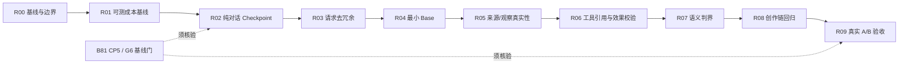

# Issue #4：单会话任务执行总契约（所有批次强制）

**仓库**：`tongsh6/ai-novel-studio`  
**目标基线**：`develop/dialogue-based-novel-workbench`，每批开工时重新核实远端 HEAD、工作区状态与 B71/B81 现状。  
**来源**：[Issue #4](https://github.com/tongsh6/ai-novel-studio/issues/4)、`tasks/NEXT.md`、`tasks/slices/B71-provider-message-fidelity.md`、`tasks/slices/B81-session-canonical-authoring-history.md`、`docs/design/contracts/VS-00L-authoring-run-transcript-request-ir-contract-pack.md`、`docs/design/contracts/VS-00I-prompt-prefix-stability-contract-pack.md`。  
**目的**：重构模型交互请求/响应的任务相关投影与治理，**不重建 AgentRun / Canonical Transcript / Request IR**。

## 每批强制的工程纪律

- **任务原子性**：本批只有一个主验收结果；禁止为了显示进度而把一个未闭环功能拆成“只写实现、后补测试、后补证据”。对应的测试和文档属于同一批完成内容。
- **单会话**：开启新的 AI 编码会话并固定一个批次号和一个提交目标；先核实依赖和冻结输入，再按“现状定位→实现→验证→提交→汇报”闭环。不得借继续对话偷偷改变目标、标准或对象。
- **有效完成判定**：`PASS` = 目标效果可观察 + 全部批次专属场景通过 + 受影响的项目必选门禁通过 + 没有新 P0/P1 + 提交 SHA 可验证。没有全部证据只可报告 `BLOCKED` 或 `FAIL`，**不叫完成**。
- **依赖检查**：如 B81 CP5、冻结协议或真实模型环境未达到前置条件，立即报告缺口并停止改代码；不能用现有不相干证据冒充。
- **禁止扩大范围**：除本批注明的文件/层次和必需测试/文档外，不改其它功能；遇到跨模块广泛调整，停止并报告拆批建议，不得擅自扩大、调低验收或引入新协议框架。
- **不允许伪证**：不得把 Stub / SliceVerify 结论说成真实模型质量；不得声称未运行的测试通过；不得改变历史作者原文字节，伪造 tool call/观察、静默删掉已存在的 canonical 历史。
- **不可突破的边界**：作者主权、tentative-first、Orchestrator gate、I1/I2/I3、N-NARR、I-CACHE、cross-work 隔离、原生工具消息顺序、`used_refs` 来源闭环、checkpoint 覆盖/版本/省略信息、三种 Provider wire 投影。
- **提交纪律**：工作区若有非本次改动，先报告；不得替用户覆盖。通过门禁后提交仅本批的文件；提交消息遵守仓库中文规范。若无代码变更的审计批次，提交独立审核文档/fixture 或按任务要求产出可复核证据。

### 每个代码批次的最低共同门禁

在仓库指定的正确环境中执行（若命令因环境缺失不可执行则 **BLOCKED**，不能写“跳过/视为通过”）：

```bash
mix compile --warnings-as-errors
mix test
mix xref graph --format cycles --label compile-connected --fail-above 0
mix run scripts/arch_check.exs
bash scripts/ai_static_scan.sh --top 10
MIX_ENV=test mix run scripts/scenario_invariants/run_i1_causal.exs
MIX_ENV=test mix run scripts/scenario_invariants/run_i2_variation.exs
MIX_ENV=test mix run scripts/scenario_invariants/run_i3_nonce.exs
MIX_ENV=test mix run scripts/scenario_invariants/run_n_narr.exs
MIX_ENV=test mix run scripts/scenario_invariants/run_icache_prefix.exs
```

项目已有 `mix check` 或当前任务指定的更严格质量门若覆盖上述项目，可使用它们，但报告必须逐项列明最终结果；不要把一次 `mix test` 的运行等同于所有门禁。若改动前端，再加 `cd frontend && pnpm typecheck && pnpm lint && pnpm test` 和项目规定的设计/前端审计门。新增场景验收只允许**产品外** driver，生产代码不得增加测试专用开关或隐藏钩子。

### 单批最终交付证明模板（每个编码会话最后必须填写）

```text
Batch: Rxx
基线: <branch + base SHA>
Outcome: PASS | FAIL | BLOCKED
目标效果实证: <具体场景、真实观察或证据文件，不能写“已实现”代替>
改动文件: <路径列表>
明确未改: <禁止触碰的范围核对>
专属测试: <命令 / 结果 / 数量>
公共门禁: <每条命令 / PASS-FAIL-未执行原因>
跨 wire: <Chat / Responses / Anthropic 结果，若本批不触碰则说明>
版本与事实不变量: <作者原文、refs、checkpoint、未授权写入的证据>
已知缺口: <无，或精确原因；有必需缺口则不能 PASS>
提交: <SHA；无提交则不能声称完成代码批次>
下批入参: <最小、真实、可复核的产出与依赖>
```

---
# AI Novel Studio — Issue #4 系统重构：单会话可闭环执行批次（方案）

> 依据 2026-11-12 读取的 `仓库活跃分支`及 Issue #4、B71/B81 任务台账形成的**建议执行方案**。未修改仓库，也未将本方案写入项目的冻结契约。实际开工以最新远端代码与作者授权为准。

## 1. 目标、排期与依赖

### 根目标（不是重新设计一个 JSON）

**让 AI Novel Studio 的模型交互在保证作者主权、真实证据、多轮连续性和创作质量的前提下，以任务相关的上下文完成自然判断与创作，并可分别审计原生模型返回、系统验证、权限放行、实际写入。**

### 关键约束

- 项目愿景：Dialogue-first / Agent-native / 最小供给、按需求证、证据闭环。
- 不发明新的 ModelInteraction 持久化真源，复用已有会话 Canonical Transcript、AgentRun、`authoring-request-ir/v1`。
- B71 已承接三 Provider wire 与流式/工具协议；B81 CP1–CP4/CP6 机制已在台账中取得阶段性结果，**B81 CP5 真实多轮页面/G6 仍待验**。不能把已有机制重新实现，也不能宣称 CP5 已过。
- 不用 `outline_in_chapter_slot` 等推断字段冒充数据库事实；卷纲占阅读章位是单独的领域结构/投影异常，本重构只以它作回归场景，不默认修改原有作品数据。
- **执行批次严格限于一次独立 AI 编码会话的范围**，每批必须完成有证据的目标效果，不能把缺测试或回归挪给下一批。

### 建议依赖图



> 它是推荐主线顺序，不强迫独立源检查必须串行开发；但每批开工时检查依赖，未通过则不能开始该批。

### 批次一览

| 批次 | 唯一结果 | 生产改动边界 | 放行依据 |
|---|---|---|---|
| R00 | 基线盘点与实施边界冻结 | 仅文档 | 独立测试与验收证据 |
| R01 | 模型请求成本与重复源可观测基线 | 仅测试/离线脚本 | 独立测试与验收证据 |
| R02 | 已完成纯对话轮次的合法 Checkpoint 支持 | 限定既有 application / common 职责 | 独立测试与验收证据 |
| R03 | Checkpoint 后的请求派生视图去冗余 | 限定既有 application / common 职责 | 独立测试与验收证据 |
| R04 | 判断阶段最小可信 Base（移除无关大正文） | 限定既有 application / common 职责 | 独立测试与验收证据 |
| R05 | 当前事实、作者要求、真实 Observation 的来源边界 | 限定既有 application / common 职责 | 独立测试与验收证据 |
| R06 | 工具效果与引用参数的确定性校验 | 限定既有 application / common 职责 | 独立测试与验收证据 |
| R07 | 讨论、纠错、明确行动的语义判界 | 限定既有 application / common 职责 | 独立测试与验收证据 |
| R08 | 专业创作链不退化回归 | 限定既有 application / common 职责 | 独立测试与验收证据 |
| R09 | 真实工作台多轮 A/B 与最终发布判定 | 产品外验收脚本/报告 | 独立测试与验收证据 |

---


具体任务卡见 R00–R09。