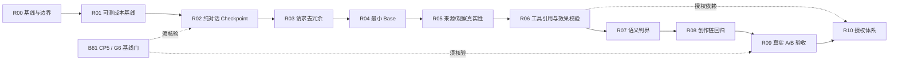

# AI Novel Studio — Issue #4 系统重构：单会话可闭环执行批次（方案）

> **状态：todo（仅登记实施方案；R00–R09 尚未执行）。**
> **任务状态唯一真源：本文件。** 关联 [Issue #4](https://github.com/tongsh6/ai-novel-studio/issues/4)；[单会话总契约](B87-model-interaction-request-projection/README.md) 与 R00–R10 独立任务卡只承载执行指令，不在卡片中重复维护任务状态或作者裁决。更新进度时只修改本文件对应 Rxx 小节，`tasks/NEXT.md` 只维护排期。当前 B81 仍是队首，本任务未启动。
> 任务卡：[R00](B87-model-interaction-request-projection/R00.md) · [R01](B87-model-interaction-request-projection/R01.md) · [R02](B87-model-interaction-request-projection/R02.md) · [R03](B87-model-interaction-request-projection/R03.md) · [R04](B87-model-interaction-request-projection/R04.md) · [R05](B87-model-interaction-request-projection/R05.md) · [R06](B87-model-interaction-request-projection/R06.md) · [R07](B87-model-interaction-request-projection/R07.md) · [R08](B87-model-interaction-request-projection/R08.md) · [R09](B87-model-interaction-request-projection/R09.md) · [R10](B87-model-interaction-request-projection/R10.md)

> 依据 2026-11-12 读取的 `仓库活跃分支`及 Issue #4、B71/B81 任务台账形成的**建议执行方案**。本文件仅为任务实施方案登记，未修改生产代码，也未变更项目的冻结契约。实际开工以最新远端代码与作者授权为准。

## 1. 目标、排期与依赖

### 根目标（不是重新设计一个 JSON）

**让 AI Novel Studio 的模型交互在保证作者主权、真实证据、多轮连续性和创作质量的前提下，以任务相关的上下文完成自然判断与创作，并可分别审计原生模型返回、系统验证、权限放行、实际写入。**

### 关键约束

- 项目愿景：Dialogue-first / Agent-native / 最小供给、按需求证、证据闭环。
- 不发明新的 ModelInteraction 持久化真源，复用已有会话 Canonical Transcript、AgentRun、`authoring-request-ir/v1`。
- B71 已承接三 Provider wire 与流式/工具协议；B81 CP1–CP4/CP6 机制已在台账中取得阶段性结果，**B81 CP5 真实多轮页面/G6 仍待验**。不能把已有机制重新实现，也不能宣称 CP5 已过。
- 不用 `outline_in_chapter_slot` 等推断字段冒充数据库事实；卷纲占阅读章位是单独的领域结构/投影异常，本重构只以它作回归场景，不默认修改原有作品数据。
- **执行批次严格限于一次独立 AI 编码会话的范围**，每批必须完成有证据的目标效果，不能把缺测试或回归挪给下一批。

### 建议依赖图



> 它是推荐主线顺序，不强迫独立源检查必须串行开发；但每批开工时检查依赖，未通过则不能开始该批。

### 批次一览

| 批次 | 唯一结果 | 生产改动边界 | 放行依据 |
|---|---|---|---|
| R00 | 基线盘点与实施边界冻结 | 仅文档 | 独立测试与验收证据 |
| R01 | 模型请求成本与重复源可观测基线 | 仅测试/离线脚本 | 独立测试与验收证据 |
| R02 | 已完成纯对话轮次的合法 Checkpoint 支持 | 限定既有 application / common 职责 | 独立测试与验收证据 |
| R03 | Checkpoint 后的请求派生视图去冗余 | 限定既有 application / common 职责 | 独立测试与验收证据 |
| R04 | 判断阶段最小可信 Base（移除无关大正文） | 限定既有 application / common 职责 | 独立测试与验收证据 |
| R05 | 当前事实、作者要求、真实 Observation 的来源边界 | 限定既有 application / common 职责 | 独立测试与验收证据 |
| R06 | 工具效果与引用参数的确定性校验 | 限定既有 application / common 职责 | 独立测试与验收证据 |
| R07 | 讨论、纠错、明确行动的语义判界 | 限定既有 application / common 职责 | 独立测试与验收证据 |
| R08 | 专业创作链不退化回归 | 限定既有 application / common 职责 | 独立测试与验收证据 |
| R09 | 真实工作台多轮 A/B 与最终发布判定 | 产品外验收脚本/报告 | 独立测试与验收证据 |
| R10 | 授权体系：风险等级、授权模式、critical/full 边界 | 限定既有 application / domain 职责 | 授权矩阵 + 真实 run 证据 |

---

# Issue #4：单会话任务执行总契约（所有批次强制）

**仓库**：`tongsh6/ai-novel-studio`  
**目标基线**：`develop/dialogue-based-novel-workbench`，每批开工时重新核实远端 HEAD、工作区状态与 B71/B81 现状。  
**来源**：[Issue #4](https://github.com/tongsh6/ai-novel-studio/issues/4)、`tasks/NEXT.md`、`tasks/slices/B71-provider-message-fidelity.md`、`tasks/slices/B81-session-canonical-authoring-history.md`、`docs/design/contracts/VS-00L-authoring-run-transcript-request-ir-contract-pack.md`、`docs/design/contracts/VS-00I-prompt-prefix-stability-contract-pack.md`。  
**目的**：重构模型交互请求/响应的任务相关投影与治理，**不重建 AgentRun / Canonical Transcript / Request IR**。

## 每批强制的工程纪律

- **任务原子性**：本批只有一个主验收结果；禁止为了显示进度而把一个未闭环功能拆成“只写实现、后补测试、后补证据”。对应的测试和文档属于同一批完成内容。
- **单会话**：开启新的 AI 编码会话并固定一个批次号和一个提交目标；先核实依赖和冻结输入，再按“现状定位→实现→验证→提交→汇报”闭环。不得借继续对话偷偷改变目标、标准或对象。
- **有效完成判定**：`PASS` = 目标效果可观察 + 全部批次专属场景通过 + 受影响的项目必选门禁通过 + 没有新 P0/P1 + 提交 SHA 可验证。没有全部证据只可报告 `BLOCKED` 或 `FAIL`，**不叫完成**。
- **依赖检查**：如 B81 CP5、冻结协议或真实模型环境未达到前置条件，立即报告缺口并停止改代码；不能用现有不相干证据冒充。
- **禁止扩大范围**：除本批注明的文件/层次和必需测试/文档外，不改其它功能；遇到跨模块广泛调整，停止并报告拆批建议，不得擅自扩大、调低验收或引入新协议框架。
- **不允许伪证**：不得把 Stub / SliceVerify 结论说成真实模型质量；不得声称未运行的测试通过；不得改变历史作者原文字节，伪造 tool call/观察、静默删掉已存在的 canonical 历史。
- **不可突破的边界**：作者主权、tentative-first、Orchestrator gate、I1/I2/I3、N-NARR、I-CACHE、cross-work 隔离、原生工具消息顺序、`used_refs` 来源闭环、checkpoint 覆盖/版本/省略信息、三种 Provider wire 投影。
- **提交纪律**：工作区若有非本次改动，先报告；不得替用户覆盖。通过门禁后提交仅本批的文件；提交消息遵守仓库中文规范。若无代码变更的审计批次，提交独立审核文档/fixture 或按任务要求产出可复核证据。

### 每个代码批次的最低共同门禁

在仓库指定的正确环境中执行（若命令因环境缺失不可执行则 **BLOCKED**，不能写“跳过/视为通过”）：

```bash
mix compile --warnings-as-errors
mix test
mix xref graph --format cycles --label compile-connected --fail-above 0
mix run scripts/arch_check.exs
bash scripts/ai_static_scan.sh --top 10
MIX_ENV=test mix run scripts/scenario_invariants/run_i1_causal.exs
MIX_ENV=test mix run scripts/scenario_invariants/run_i2_variation.exs
MIX_ENV=test mix run scripts/scenario_invariants/run_i3_nonce.exs
MIX_ENV=test mix run scripts/scenario_invariants/run_n_narr.exs
MIX_ENV=test mix run scripts/scenario_invariants/run_icache_prefix.exs
```

项目已有 `mix check` 或当前任务指定的更严格质量门若覆盖上述项目，可使用它们，但报告必须逐项列明最终结果；不要把一次 `mix test` 的运行等同于所有门禁。若改动前端，再加 `cd frontend && pnpm typecheck && pnpm lint && pnpm test` 和项目规定的设计/前端审计门。新增场景验收只允许**产品外** driver，生产代码不得增加测试专用开关或隐藏钩子。

### 单批最终交付证明模板（每个编码会话最后必须填写）

```text
Batch: Rxx
基线: <branch + base SHA>
Outcome: PASS | FAIL | BLOCKED
目标效果实证: <具体场景、真实观察或证据文件，不能写“已实现”代替>
改动文件: <路径列表>
明确未改: <禁止触碰的范围核对>
专属测试: <命令 / 结果 / 数量>
公共门禁: <每条命令 / PASS-FAIL-未执行原因>
跨 wire: <Chat / Responses / Anthropic 结果，若本批不触碰则说明>
版本与事实不变量: <作者原文、refs、checkpoint、未授权写入的证据>
已知缺口: <无，或精确原因；有必需缺口则不能 PASS>
提交: <SHA；无提交则不能声称完成代码批次>
下批入参: <最小、真实、可复核的产出与依赖>
```

---
## R00 — 基线盘点与实施边界冻结

**唯一目标**：形成唯一、可核对的 Issue #4 实施基线，不写生产代码，不先发明新 Request IR。

**开工依赖**：无；必须读取目标分支最新 HEAD、Issue #4、B71/B81 当前状态。

**允许改动**：文档/验证输入：tasks/NEXT.md、B71/B81、VS-00L、VS-00I、ADR-0035、相关 modules/test；只新增或更新 Issue #4 对应的任务设计/对账文档。

**禁止改动**：不改生产逻辑、Schema、Prompt 文案、Provider Adapter、历史数据；不能把 B81 的已实现机制重复列作新建任务。

**本批执行步骤**：

1. 检视活跃分支、工作区、B81 CP5 / G6 当前状况及相关冻结契约；逐条列明已有、缺失、待决。
2. 画出“canonical session → run segment → request derived view → Request IR → 三 wire → validation/outcome”当前真实数据流，给出源文件入口。
3. 用用户提供的三轮真实日志建立**基线事实表**（16,462 / 27,540 / 39,772 input tokens；缓存是 input 的子集），明确哪些数字属于真实日志，哪些仅估算。
4. 预注册本重构的正例/反例：统计、讨论、明确修复、跨轮引用、真实探索、长篇创作、不完整证据、跨作品隔离。
5. 列出 R01–R09 对现有合同的冲突点与授权门槛；若需改 Frozen 契约，先形成 ADR/契约裁决建议，不自签已批准。

**必须全部满足的 DoD**：

- [ ] 产出一份**单一权威**设计/任务对账记录；所有关键结论有仓库来源及代码定位。
- [ ] 单独标明 B81 CP5 尚需的证据与后续 R02/R03 的实际开工前提。
- [ ] 每个后续批次有独立验收输入，不提前规定模型判断结果为“作品事实”。

**专属验证**：文档内部自检 + 现有契约/任务关联审计；没有生产改动不必伪称运行代码门禁。

**交付物**：一份本 Issue 专用 SSOT 任务对账文档，含可追踪文件路径、冻结/待裁决表和前置条件清单。

---

## R01 — 模型请求成本与重复源可观测基线

**唯一目标**：取得可复核的“每轮请求为何增长”证据，明确 bytes/tokens/cached、原生消息与来源类型，而非凭文本长度猜测。

**开工依赖**：R00 已确认来源；需要三轮原始请求日志或等价合法重放。若实际样本不可得则 BLOCKED，不伪造真实基线。

**允许改动**：只允许测试/离线脚本及其 fixtures/报告；优先复用 scripts/model_contracts、run_icache_prefix.exs 与 RequestIR.Projection 的捕获接口。

**禁止改动**：不改变生产请求、Schema、tokenizer/Provider 计费口径、缓存策略或日志安全机制；禁止记录密钥及真实私人原文到公开制品。

**本批执行步骤**：

1. 使用真实 Request IR / Provider 投影捕获：system、tools、current scope、previous scopes、dialogue、observation、raw author turn。
2. 按 role/source/call_site/run 计算字节量、已知 token 统计、缓存命中与重复块；没有准确 tokenizer 则将 byte 与 token 分开标注。
3. 输出三轮前缀共享、scope 数、重复材料数量与“本轮最小必要事实”人工审阅表。
4. 编写确定性测试确认统计器不修改 Request IR、不泄漏作者内容和 secrets。

**必须全部满足的 DoD**：

- [ ] 三轮报告可复现且分组加总与原请求 body 相符。
- [ ] 精确区分 input_tokens、cached_tokens（子集）、output_tokens；不把 TTFT 变化当作唯一性能因果证据。
- [ ] 不触碰生产请求行为。

**专属验证**：脚本/测试自检 + 现有 I-CACHE 检测；若新增代码受 AGENTS 规范约束，照共同门禁执行。

**交付物**：脱敏基线报告、测试夹具、固定 A/B 指标定义，为 R02/R03 和 R09 使用。

---

## R02 — 已完成纯对话轮次的合法 Checkpoint 支持

**唯一目标**：填补没有工具交换的纯 user/assistant 轮次无法有效整理的缺口，使后续请求有可引用的合法历史检查点。

**开工依赖**：R00/R01；必须先核验 B81 CP5 的真实多轮基线与 ADR-0035 / VS-00L 的压缩许可；若 Frozen 契约不允许扩充覆盖范围，先走契约裁决，停止本批。

**允许改动**：首选 NovelApplication.TranscriptCompaction / AuthoringCheckpoint 既有压缩职责、对应会话测试；必要消费者仅限现有压缩安全点；不得新建第二 checkpoint 存储。

**禁止改动**：不直接改 Provider 投影、不压缩活跃轮、未闭合 tool calls、未回答作者问题；不压缩改变作者文字或 artifact 字节。

**本批执行步骤**：

1. 定位纯对话完成轮次为何不入已完成交换压缩组，定义完整轮次的可安全整理条件。
2. 在现有 checkpoint 机制中承接纯对话的完整覆盖、来源、版本和遗漏说明；原 transcript 追加不可变。
3. 覆盖纯对话、工具交换、混合、跨 run、空历史、重复整理、取消/失败、错误版本的负例。
4. 证明 Replay 可回查原文及 checkpoint，并在异常数据下 fail-closed。

**必须全部满足的 DoD**：

- [ ] 纯对话历史达到**经批准**的安全点条件时可产生有效 checkpoint；未满足则不产生。
- [ ] checkpoint 能精确覆盖对应历史、可追溯、幂等；不丢作者原话、工具引用或未结束交互。
- [ ] B81 原有压缩/恢复/多轮校验全部回归。

**专属验证**：指定目标 ExUnit + b81_cp3_session_compaction_test.exs / b81_cp4_session_replay_test.exs + 全部门禁。

**交付物**：当前压缩链的增量能力与对应的确定性证明。

---

## R03 — Checkpoint 后的请求派生视图去冗余

**唯一目标**：让完成压缩的历史 Scope 不再以全文重复进入后续 Provider 请求，同时仍通过 checkpoint 可核查，避免三轮内容无变化时全量 Scope 无界线性累积。

**开工依赖**：R02 完成；B81 CP5 与 VS-00L 请求派生要求已满足；没有合法 checkpoint 时不能静默省略历史消息。

**允许改动**：优先 AuthoringSessionHistory.compose/2、JudgmentProtocol.request_for_production/2 现有派生边界，RequestIR.Projection 测试；仅必要的压缩消费接线。

**禁止改动**：不修改 canonical storage，不改作者原话原字节，不压缩当前仍有效的行为义务，不能改成只有 latest scope 且丢旧证据。

**本批执行步骤**：

1. 实现“当前有效 Scope + 有来源的 checkpoint + 需要的近期原生交换”派生规则。
2. 校验 checkpoint 实际覆盖、source_refs、versions、omissions；未覆盖部分保持完整原序。
3. 检查 used_refs 与 base/observations 关联，跨 run/跨作品/版本漂移时拒绝或明确降级。
4. 对相同统计事实连续 3、10、20 轮做无界增长反例，使用 R01 同一口径报告 before/after。

**必须全部满足的 DoD**：

- [ ] canonical 持久内容、追溯与 Replay 不变；Provider 视图无旧 Scope 无界重复。
- [ ] 无 checkpoint 不得实现静默删历史的“优化”。
- [ ] Chat Completions / Responses / Anthropic 的消息顺序、来源与引用闭环通过测试。

**专属验证**：b81_cp2_session_derivation_test.exs + judgment_initial_snapshot_test.exs + 三投影 round-trip 与 I-CACHE 等共同门禁。

**交付物**：一个可独立观察的新请求派生行为与 R01 口径的成本对比报告。

---

## R04 — 判断阶段最小可信 Base（移除无关大正文）

**唯一目标**：在不预判用户语义的前提下，判断阶段默认提供必要权威事实和对象身份，而非完整角色档案、候选正文和多份历史全文。

**开工依赖**：R03；必须通过 R00 审定的不可省略 Base 最低集合。

**允许改动**：优先 JudgmentProtocol 的 scope 组装、当前 ContextAssembler/DialogueContext 的投影出口及对应 judgment context tests；只改首个判断消费者。

**禁止改动**：不新增关键词路由、意图分类 Router、不删除必要对象 refs/权限、不强制 writer/修订器复用判断阶段的瘦上下文。

**本批执行步骤**：

1. 定义判断阶段的必带集合：作者原话、作品/会话身份与当前权威版本、必要章节索引/统计、合法身份 refs、工具目录/预算/权限。
2. 长角色说明、resolved/pending 历史 body_preview 与正文改为摘要/引用入口（如当前任务确需，应按现有探索工具读取）；保持可发现性。
3. 对“当前章数”和“已有角色改成主角/改已有候选/章节修订”场景分别验证：第一类少读，后几类可取回所需身份/全文，不要求作者重新提供系统已有事实。
4. 使用 R01 统计 before/after：少了什么，有什么证据，是否出现错误遗漏。

**必须全部满足的 DoD**：

- [ ] 简单统计请求不含无关长角色全文/候选全文；必要 refs 未丢。
- [ ] 已有对象修订、待采纳候选、非唯一目标、跨作品隔离保持原行为。
- [ ] 真正需要全文的请求能经授权只读探索补足；不编造内容。

**专属验证**：b27_request_source_test.exs + judgment_protocol_test.exs + character_roster_context_test.exs + judgment_exploration_loop_test.exs + 共同门禁。

**交付物**：判断阶段最小 Base 变更与原始请求差异证据。

---

## R05 — 当前事实、作者要求、真实 Observation 的来源边界

**唯一目标**：系统不能把“作者想要的结果”标记为已发生事实，不能把应用基础投影伪装成已调用工具的 Observation。

**开工依赖**：R00、R04；检查 VS-00L / RequestIR 当前 provenance/refs 能否承载；若需主协议字段变更先获契约批准。

**允许改动**：优先现有 RequestIR / JudgmentProtocol 的请求事实投影与来源校验，相关 tests；不建新持久事实表。

**禁止改动**：不引入第二模型交互事实源、不凭标题推造 artifact_type、不自动生成 observations、不把作者指令塞进 application scope 冒充系统事实。

**本批执行步骤**：

1. 对输入区分四类：base_facts、author_requirements（由真实作者消息引用）、model_inference、tool_observations。
2. 为每类定义允许的 source_ref、version、coverage/status 与事实引用规则；已存在结构优先复用。
3. 测试应用章索引不会出现伪 tool_call；真实 chapter_read 才产生 observation 且绑定真实 call_id；未读、stale、partial 诚实传递。
4. 保持三 Provider 原生消息投影与后续模型消费的一致性。

**必须全部满足的 DoD**：

- [ ] 无法以应用统计冒充“已读取整章”或“已执行 work_archive_read”。
- [ ] 作者期望与当前状态不会因请求组装混同。
- [ ] 已绑定的真实 refs、投影顺序及旧消息回放行为保持。

**专属验证**：judgment_initial_snapshot_test.exs + authoring_transcript_test.exs + authoring_execution_refs_test.exs + 相关三投影回归 + 共同门禁。

**交付物**：来源类型与已验证绑定行为，不是另一份持久化 JSON 真源。

---

## R06 — 工具效果与引用参数的确定性校验

**唯一目标**：确保工具引用字段只携带真实目录标识、业务效果与能力范围机械一致，验证成功不等于执行授权。

**开工依赖**：R00、R05；工具 Schema 若必须变更，先冻结版本或批准契约迁移。

**允许改动**：优先 JudgmentToolContract 与 JudgmentProtocol 已有 validate_operation / ExecutionOrchestrator；尽量只增强现有引用和效果判定。

**禁止改动**：不大规模重写七工具 schema、不让模型直接 adopt/canon_write、不将 report_capability_gap 冒充业务创作能力。

**本批执行步骤**：

1. 新增/补全针对 alternative_operation_refs 的真实 catalog id 校验，不接受“标识符（说明文字）”拼接。
2. 验证 judgment_decision 的 action 对应字段互斥、真实 target ref、错作品、不存在目标、能力不支持、重复/歧义。
3. 模型提出可用能力但无授权时仍只记录 validated，必须由后续 gate 放行；缺能力只能准确报告缺口。
4. 工具错误生成与原因一致的结构化失败，修复重试不得扩大当前目标/对象/权限。

**必须全部满足的 DoD**：

- [ ] 非法引用/不合法 schema、错误 effect 100% 由系统拒绝。
- [ ] model tool_call → passed validation → authorized execution → actual write/adoption 分开可证明。
- [ ] 现有合法调用/plan 双工具组合不退化。

**专属验证**：judgment_protocol_test.exs + judgment tool schema/contract tests + execution_authority_test.exs + 共同门禁。

**交付物**：工具/效果边界有效、可拒绝错误引用、无越权的测试证据。

---

## R07 — 讨论、纠错、明确行动的语义判界

**唯一目标**：避免作者只是讨论时模型过早调用能力缺口/动作，同时在作者明确授权目标时能够继续执行或准确报告缺口。

**开工依赖**：R04、R06；需与 B27 既有模型语义矩阵与冻结规则冲突对账。

**允许改动**：优先 AuthoringTaskPolicy、既有 JudgmentProtocol / TurnInteractionService 的当前判别语义与相关测试；只改已经证明确有冲突的规则。

**禁止改动**：禁止新增 if/contains 语句专门识别“卷纲”等词、硬编码某个用户或小说输入；禁止为通过某一场景削弱其他创作请求。

**本批执行步骤**：

1. 将“章状态是否完成”与“文学意义写完了吗”分开；提供事实分类和必要取证边界，不重复冲突判例。
2. 建立最小对比语义矩阵：事实询问、结构异议/讨论、明确效果请求、条件句否定、明确生成、缺信息、缺能力。
3. 用同一真实上下文测三轮判界；讨论回合只回复，明确要求缺能力时报告缺口；不检查未读正文就宣称质量已通过。
4. 确定性机制测试之外，实模质量单独记为待 R09 复证，不用 stub“证明模型真正理解”。

**必须全部满足的 DoD**：

- [ ] 针对用户真实三轮输入的决策语义不发生误升级。
- [ ] 其它负例、已有候选修订/作者明确生成/作者只说“先收下”不发生回归。
- [ ] 系统层仍不预先声明模型应当认为的具体意图。

**专属验证**：b27_request_source_test.exs + b34_author_intent_fixture_test.exs + judgment_protocol_test.exs + B27 模型语义负例矩阵（在可用模型环境下） + 共同门禁。

**交付物**：可独立运行的语义回归矩阵与收敛后的唯一规则真源。

---

## R08 — 专业创作链不退化回归

**唯一目标**：确保瘦化判断上下文与历史压缩不会破坏真正需要完整正文、章计划、人物状态和作者风格的创作链。

**开工依赖**：R03–R07 已通过；现有作品/修订/作者原文/质量契约为准。

**允许改动**：以现有 writer/prose revision/quality 入口及测试为主，新增端到端机制夹具和小范围回归修复；如果发现较大独立缺陷，创建单独任务，不在本批展开新功能。

**禁止改动**：不重构 Writer、不更换小说质量算法、不新增作者资产系统、不以压缩/summary 代替整章修订的必要全文。

**本批执行步骤**：

1. 验首稿、续写、指定片段修订、整章修订、纯排版、角色已有档案修改、缺证据取证，覆盖作者限制/版本/对象一致性。
2. 检验 writer 实际接收到目标正文及完整基线（需要全章时不能只用片段），未采纳产物不污染 canonical。
3. 对作者素材/文风所需事实仅验证存在按需扩展路径，不在此实现 Issue #3。
4. 将确认的回归问题限定于此次 Context Projection 引入的差异，修复和场景一同提交。

**必须全部满足的 DoD**：

- [ ] 所有专业创作入参保持完整性、来源、范围及作者原话字节。
- [ ] 现有 prose writing / revising / quality / adoption tests 通过，0 个未授权写入。
- [ ] 不存在用短摘要或单段冒充完整章节修订。

**专属验证**：agent_run_prose_drafting_flow_test.exs + agent_run_prose_revision_flow_test.exs + prose_execution_brief_builder_test.exs + quality tests + 共同门禁。

**交付物**：专业创作链零退化机制证明和若干真实产物校验输入。

---

## R09 — 真实工作台多轮 A/B 与最终发布判定

**唯一目标**：在严格同口径 A/B 中验证 Token、缓存、延迟、语义判断和事实一致性，得出是否可合并/发布的证据结论。

**开工依赖**：R00–R08 PASS；B81 CP5/G6 所需证据完成或明确与当前批次合并验证；**真实模型、Tauri、测试驱动与预注册样本可用**，否则 BLOCKED，不降低验收。

**允许改动**：仅产品外 Tauri 驱动、测试报告和必要的自身验收脚本修复；不在本批顺手改生产内核或额外增加业务功能。

**禁止改动**：不改变样本/阈值掩盖失败、不编造实模/前端证据、不为跑测试在生产代码加特殊路径。

**本批执行步骤**：

1. 冻结同一作品、三轮作者原话及若干逆向样本的前后请求（model/provider/推理/缓存/并发条件记录）。
2. 从真实桌面工作台执行：统计 → 异议讨论 → 明确结构效果；加跨轮引用、checkpoint 触发、授权只读探索、失败/取消和作者采纳边界。
3. 分别采集 A/B 的实际 input/output/cached tokens、请求组成、TTFT、latency、工具选择、结果正确性；缓存不能算作新增输入。
4. 复跑三 Provider wire 投影与 I1/I2/I3/N-NARR/I-CACHE，确认原始消息顺序/来源、跨作品、回放和真实阅读投影。
5. 按预注册规则判定 PASS/FAIL/BLOCKED，将所有残余问题准确归因到批次与已有任务，不为凑最终 PASS 改历史结论。

**必须全部满足的 DoD**：

- [ ] 真实 3 轮对话正确：问章数不读取无关全文；讨论不误授权；明确移出卷纲目标不以重编号冒充已修。
- [ ] 请求多轮旧 Scope 无无界增长，报出 before/after 的数值与模型表现，无虚假的“固定降幅保证”。
- [ ] 真实 Tauri + 有效模型证据、三 wire/全部门禁与完整 trace；必要缺口必须 FAIL/BLOCKED。

**专属验证**：bash scripts/quality_accept.sh <本批注册的真实场景 ID> --surface tauri；B81/G6 对应驱动；完整共同门禁；实模依预注册工具/环境操作。

**交付物**：最终 A/B 报告、实模与 UI 证据路径、剩余风险判断、Issue #4 完成/不完成建议；不得自动宣称业务领域问题（卷纲数据修复）已解决。

---

## R10 — 授权体系：风险等级、授权模式与 critical/full 边界

**唯一目标**：在现有 RequestIR / JudgmentProtocol / Orchestrator gate 上增加可机械校验的授权层——能力风险等级（按 capability + effect + target 动态）、用户授权模式（manual / risk_based / full / smart，run > 会话 > 作品 > 全局）、critical 询问作者、full 自动采纳的委托与审计；不修改 RequestIR 真源，不新建 ModelInteraction 持久化结构。

**开工依赖**：R05、R06 PASS；[VS-00M](../../docs/design/contracts/VS-00M-model-interaction-request-response-contract-pack.md) §3.4/§3.6 作为设计输入；B81 当前机制不重做；若需改 Frozen 契约，先获 ADR/契约批准。

**允许改动**：优先 application 的授权决策/风险规则模块、Orchestrator gate、JudgmentProtocol 的 authorized 派生与 validation 字段；domain 纯函数 `risk_of/4`；相关 tests。

**禁止改动**：不新建 ModelInteraction 持久化真源；不重写 RequestIR 三 wire 投影；不让模型自评风险或自授模式；`full` 自动采纳不得绕过 adoption boundary / I1 / validation；不改变现有七工具语义。

**本批执行步骤**：

1. 定义 `risk_of(capability, effect, target, context)` 纯函数与可版本化规则表：low / medium / high / critical；critical = 删除、批量（≥3 对象）、不可逆覆盖、跨作品、改 canon 核心。
2. 实现授权模式解析：run > 会话 > 作品 > 全局；记录 `mode_source`；模型不可设置或修改模式。
3. 实现 `authorized` 派生：从 `authority_scope.allowed_tools` + profile/step + 前置条件 + budget 派生，替换判断器硬编码 `@judgment_capabilities`；catalog 仍按需 `capability_lookup`，不预装。
4. 实现决策矩阵：low/medium/high/critical × manual/risk_based/full/smart；critical 恒 `ask_author`（同意=执行+采纳，拒绝回流，永不自动采纳）；full 自动采纳需 `delegation_ref`、可撤销、可回滚、`status_message` 明确标注。
5. validation / truthfulness 增加 `risk_decision` / `author_decision` / `auto_adopted` / `author_confirmed` / `author_delegation_ref`；系统回填，模型不能自填。

**必须全部满足的 DoD**：

- [ ] 授权矩阵与 VS-00M §3.4.3 一致；critical 恒询问作者；full 自动采纳有 `delegation_ref` 且可回滚。
- [ ] `authorized` 从 run 事实派生，与执行 gate 同源；模型建议 ⊆ authorized。
- [ ] 风险函数可重算；模型不能自评/自授；不破 I1 / N-NARR / I-CACHE。
- [ ] 现有判断/创作/修订链不退化；三 wire 投影不变。

**专属验证**：authorized/risk policy 单测 + 授权矩阵负例 + judgment_protocol_test + execution_authority_test + 共同门禁 + 一次真实 run 证据。

**交付物**：授权体系实现、矩阵负例、真实 run 证据、full 自动采纳审计样例。

**硬性执行约束**：本会话仅执行 R10，开工先核查 README 中的总契约和分支 HEAD。未经作者重新裁决不得扩展范围或降低要求。PASS 必须有真实场景、完整门禁、证据和可验证提交 SHA；任何必选条件不具备即 BLOCKED，不允许把未完成标为完成。

---

## 2. 为什么不能把十一批合并成一个“大重构”

- R02/R03 改的是会话历史与请求派生，属于最容易破坏作者连续性/证据的高风险边界，不能同时改 R04 的材料集合和 R07 的意图判界，否则失败难归因。
- R05 证明事实来源真实性，R06 证明工具协议可校验，R07 才能证明判断语义行为；先分解证据链，再讨论模型本身的准确性。
- R08 是“不能因优化请求而降低创作效果”的独立防线；R09 则验证作者实际体验。两者不互相代签。
- **缩减工作量的方法是缩小批次目标，不是缩小某个批次的验收门禁**。如果一个批次在执行中发现超过其界限，必须停止，先修订计划/依赖再创建新的完整闭环批次。

## 3. 指令使用方法

1. 为每批新建独立的 Codex CLI / Claude Code / OpenCode 会话（不要在同一聊天里滚动执行十个批次）。
2. 给模型提供本总契约、**仅当前批次**任务卡和仓库可访问权限；让 Agent 自行读取该分支的真实代码/任务文档，不能以本计划中的旧示例当当前代码事实。
3. 每批结束仅接受完整 `PASS` 证据或如实 `FAIL/BLOCKED`，不接受“下次补测试/等以后实模”。
4. 通过后再启动下一批；建议将批次完成结论回填 Issue #4 或项目既有任务 SSOT，避免重复台账。

**注意**：一次有效会话不意味着强迫 AI 在外部依赖缺失时制造成功。硬件/凭证/冻结契约冲突属于真实阻塞，应先解除条件，再启动或重新安排该批。没有任何任务描述能绝对保证模型不会跑偏；能可靠保证的是没有独立证据就不得将偏离结果判为完成。